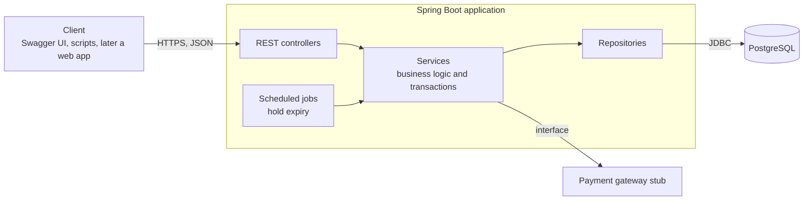
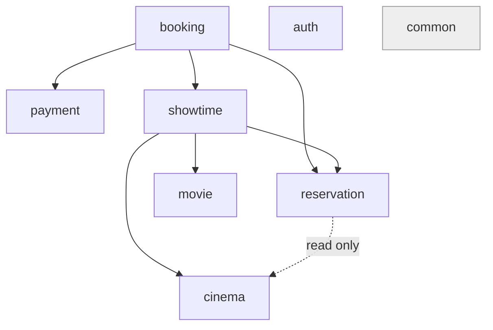
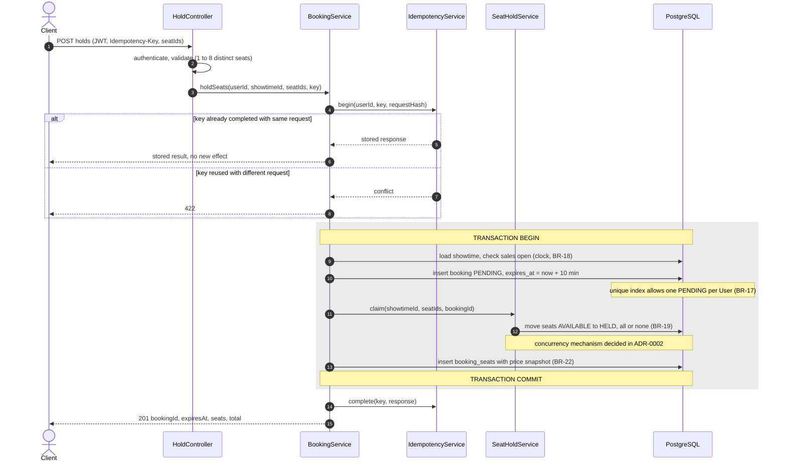
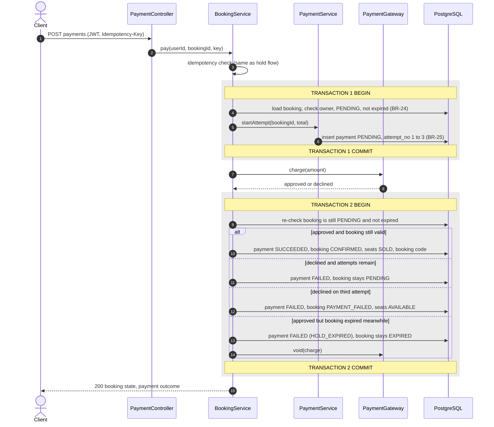
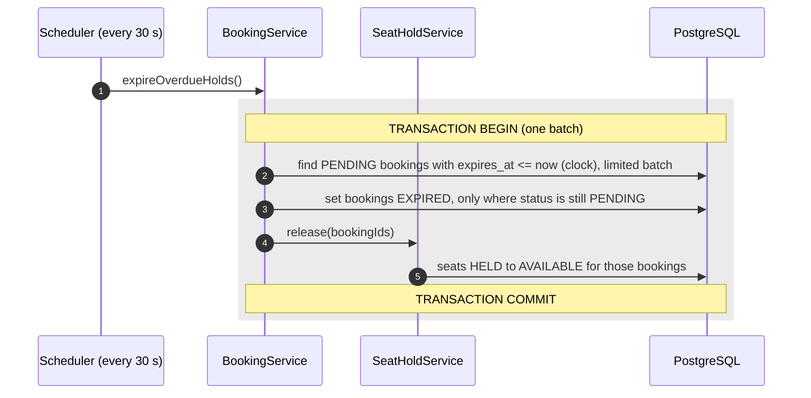
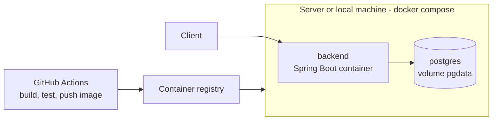

# Architecture

How the system is organized and how its core flows work. Decisions that needed a comparison of alternatives are recorded in [docs/adr](adr/). Data structures are in [erd.md](erd.md), lifecycles in [state-machines.md](state-machines.md).

## 1. Overview

A **modular monolith**: one Spring Boot application, one PostgreSQL database, split internally into modules with explicit dependency rules.



### Why a modular monolith and not microservices

- The hardest part of this system is **consistency**: holding seats and confirming a booking must change several tables atomically. In a single database that is one transaction. Across services it would need sagas or distributed transactions, which solve no problem the system has.
- One deployable unit is easier to test (one Testcontainers database), to run (`docker compose up`) and to debug.
- Modules with enforced boundaries keep the option open: a module that really needs to scale independently can be extracted later, because other modules already talk to it through an interface.
- Kubernetes and microservices are understood conceptually (pod, deployment, service) but deliberately not used here.

## 2. Modules

| Module | Responsibility | Owns tables |
|---|---|---|
| `auth` | Registration, login, refresh tokens, JWT, security configuration | `users`, `refresh_tokens` |
| `movie` | Movies, genres, age ratings, public movie queries | `movies`, `genres`, `movie_genres` |
| `cinema` | Cinemas, rooms, physical seats | `cinemas`, `rooms`, `seats` |
| `showtime` | Scheduling, overlap checks, showtime queries | `showtimes` |
| `reservation` | Seat state per showtime, claiming and releasing seats, seat map. Hidden behind a `SeatHoldService` interface | `showtime_seats` |
| `booking` | Booking lifecycle, orchestration of hold, release and pay, expiry job, booking history | `bookings`, `booking_seats` |
| `payment` | Payment attempts and the gateway interface with its simulated implementation | `payments` |
| `common` | Error handling, response format, time (`Clock`), correlation id, idempotency | `idempotency_keys` |
| `config` | Spring configuration, profiles, OpenAPI | none |

### Dependency rules



- Arrows point from the module that depends to the module that is depended on. Every module may use `common`.
- **No cycles.** `payment` does not know about bookings: it receives a booking id and an amount. `reservation` does not know about bookings beyond an id.
- A module calls another only through its public service interface, never its repositories or entities.
- **One documented exception:** the seat-map query joins `showtime_seats` with `seats` in a single read-only SQL statement, because reading it module by module would be slow (NFR-01). Writes never cross module boundaries this way.
- These rules can be enforced with an architecture test (for example ArchUnit) so a violation fails the build.

## 3. Layers inside a module

```
controller  →  service  →  repository  →  database
   (HTTP)     (rules and      (SQL, JPA)
              transactions)
```

- **Controllers** translate HTTP to method calls: parse and validate input, check access, map DTOs. They contain no business logic.
- **Services** hold the business rules and **own the transaction boundary** (`@Transactional` lives here, never on controllers or repositories).
- **Repositories** only read and write data.
- **Entities never leave the service layer.** Controllers exchange DTOs, so the API can evolve without changing the schema.

## 4. Package structure

```
<base-package>
├── auth/          controller, service, dto, security config
├── movie/
├── cinema/
├── showtime/
├── reservation/   SeatHoldService (interface) and its implementation
├── booking/
├── payment/       PaymentGateway (interface) and SimulatedPaymentGateway
├── common/        exception handling, response format, time, idempotency
└── config/
```

Each module contains `controller`, `service`, `repository`, `entity` and `dto` packages.

## 5. Core flows

All sequence diagrams show where transactions begin and end, because that is where correctness is decided. The mechanism that makes the seat claim safe under concurrency is chosen in **ADR-0002 (Sprint 4)**; the diagrams mark that step as "claim seats" and are updated once the ADR exists.

### 5.1 Hold seats

`POST /api/v1/showtimes/{showtimeId}/holds` with header `Idempotency-Key` (US-15, BR-14 to BR-19).



**Failure handling**

| Failure | Result |
|---|---|
| A requested seat is not available | The whole transaction rolls back (booking row and any claimed seat); response `409`. Nothing is held (BR-19). |
| The User already has a `PENDING` booking | Unique index violation, transaction rolls back; response `409`. |
| Sales closed, or more than 8 seats | Rejected before any write; response `422`. |
| Server error after commit but before the response | The client retries with the same key and receives the stored result (US-19). |

### 5.2 Pay for a booking

`POST /api/v1/bookings/{bookingId}/payments` with header `Idempotency-Key` (US-18, US-20, BR-23 to BR-27).

The gateway call happens **outside** any database transaction. Holding a transaction (and its locks and pooled connection) open while waiting for an external service would block other requests and could exhaust the connection pool.



**Why two transactions.** The attempt is recorded before the gateway call, so a crash leaves a visible `PENDING` payment rather than a charge with no trace. The second transaction re-checks the booking because it may have expired while the gateway was working.

**Payment versus expiry.** Payment success and expiry can occur at nearly the same moment. Exactly one must win and the loser must change nothing. The ordering guarantee is part of ADR-0002 and has a dedicated concurrency test. If the payment loses, the simulated charge is voided and the payment is recorded as `FAILED` with reason `HOLD_EXPIRED`, which keeps the payment state machine unchanged.

### 5.3 Release expired holds

A scheduled job (US-16, BR-20, BR-21, NFR-05).



- The job is **safe to run twice**: updates are guarded by `status = 'PENDING'`, so a second run finds nothing to do.
- A failure rolls back the batch; the next run retries it.
- Correctness does not depend on the job. A seat with an expired hold is already treated as available by every read and write (BR-20). The job only makes the stored data catch up, within 60 seconds.
- Batch size is limited so one run never holds a long transaction.

## 6. Cross-cutting concerns

| Concern | Approach |
|---|---|
| **Security** | A stateless filter validates the JWT access token and sets the User and role. Each endpoint declares its access rule explicitly (NFR-07). Secrets come from environment variables. |
| **Errors** | One `@RestControllerAdvice` maps exceptions to a single JSON shape: timestamp, status, machine-readable code, message, path, correlation id. Stack traces are never returned. |
| **Time** | All logic reads time from an injected `Clock` in UTC, so hold expiry is testable by moving a fake clock. |
| **Idempotency** | `IdempotencyService` in `common`, used by hold and pay. Details are designed at the start of Sprint 5. |
| **Logging** | Each request gets a correlation id included in every log line. Booking and payment state changes are logged. Passwords and tokens are never logged. |
| **Metrics** | Micrometer counters and timers for hold success and failure and hold latency, exposed through the Actuator (NFR-09). |
| **API style** | Versioned base path `/api/v1`, pagination per BR-31, OpenAPI generated from the code. |
| **Configuration** | Spring profiles `dev`, `test`, `prod`; sensitive values only from the environment; `.env.example` documents them. |

## 7. Deployment view



CI runs on every pull request (build, unit and integration tests against a real PostgreSQL). CD runs on merge to `main`. A web frontend, when added, becomes one more container in the same compose file.

## 8. Open points

| Topic | Decided in |
|---|---|
| How concurrent seat claims and the payment-versus-expiry race are coordinated | ADR-0002 (Sprint 4) |
| Idempotency flow for requests still in progress | Start of Sprint 5 |
| Whether to cache the seat map | ADR-0003, only if a load test shows a bottleneck |
