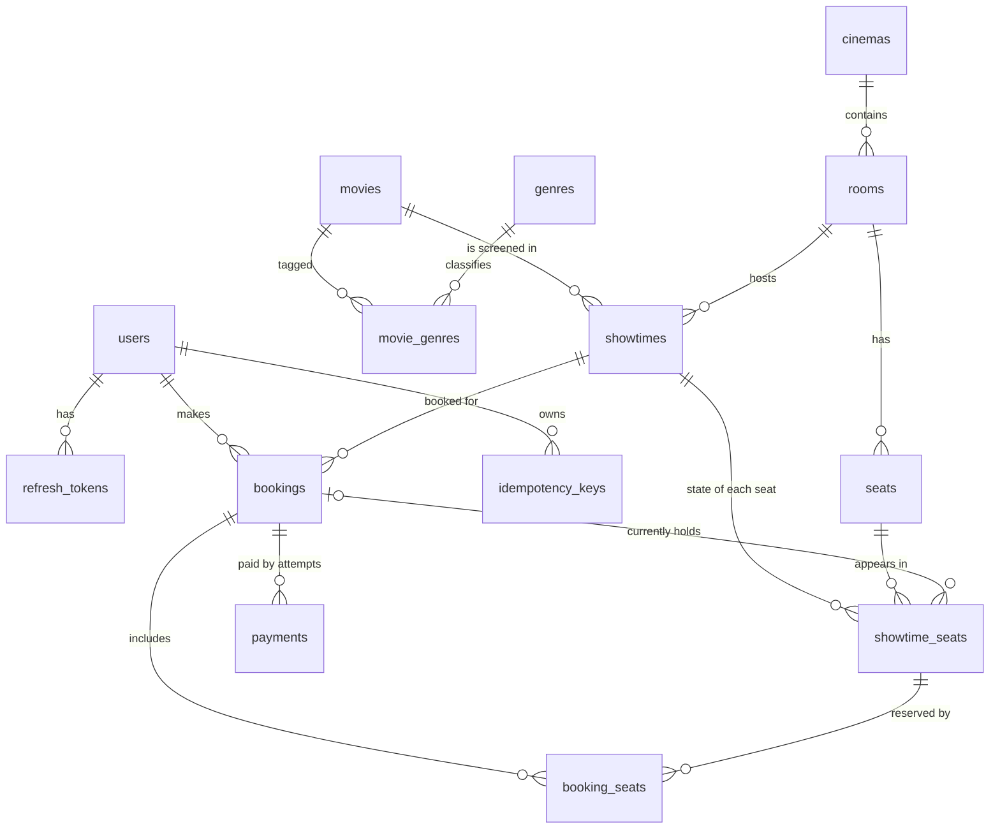

# Data model (ERD)

The relational schema for the platform, targeting PostgreSQL (see [ADR-0001](adr/0001-tech-stack-and-database.md)). It is the starting point: later sprints change it only through new Flyway migrations, never by editing old ones.

Related documents: lifecycles in [state-machines.md](state-machines.md), rules in [requirements.md](requirements.md).

## 1. Conventions

- Primary keys are `bigint` identity columns, except pure link tables, which use a composite key.
- Timestamps are `timestamptz`, always UTC. Money is an integer amount in VND (`bigint`).
- Status columns are `varchar` with a `CHECK` constraint listing the allowed values. This is easy to evolve with migrations.
- Foreign keys use `ON DELETE RESTRICT` unless stated otherwise, so referenced data cannot disappear silently.
- Tables that Admins edit carry a `version` column for optimistic concurrency checks (BR-13).

## 2. Entity relationship overview



## 3. Answers to the key design questions

**Where is the state of a seat in one showtime stored?**
In `showtime_seats`: one row per (showtime, seat), created when the showtime is created. The physical seat (`seats`) never changes state; only its appearance in a showtime does.

**How does a physical seat differ from a seat in a showtime?**
`seats` describes the room: row, number and type. It exists once. `showtime_seats` describes availability for one screening. Seat A1 can be `SOLD` at 18:00 and `AVAILABLE` at 20:00 because those are two different rows.

**Which database constraints stop double booking?**
- `UNIQUE (showtime_id, seat_id)` on `showtime_seats` means a seat has exactly one state row per showtime.
- That row points to at most one booking through `booking_id`, so a seat cannot belong to two active bookings at once (invariant I-1).
- The constraints guarantee that the stored data cannot describe a double booking. How concurrent requests are coordinated when they race for the same row (locking, conditional update, version check) is the decision of ADR-0002 in Sprint 4. The schema supports any of them.

## 4. Tables

### Accounts

**users**

| Column | Type | Notes |
|---|---|---|
| id | bigint PK | |
| email | varchar(255) | Unique, case-insensitive (BR-01) |
| password_hash | varchar(255) | BCrypt (NFR-06) |
| role | varchar(20) | `USER` or `ADMIN` |
| created_at | timestamptz | |

**refresh_tokens**

| Column | Type | Notes |
|---|---|---|
| id | bigint PK | |
| user_id | bigint FK users | |
| token_hash | varchar(64) | Unique; only the hash is stored (BR-34) |
| expires_at | timestamptz | 7 days after issue (BR-32) |
| used_at | timestamptz null | Set when rotated; a second use triggers revocation of all the User's tokens (BR-33) |
| revoked_at | timestamptz null | Set on logout or reuse detection |
| created_at | timestamptz | |

### Catalog

**genres**: `id`, `name` (unique, case-insensitive).

**movies**

| Column | Type | Notes |
|---|---|---|
| id | bigint PK | |
| title | varchar(255) | |
| description | text | |
| duration_minutes | int | `CHECK > 0` |
| age_rating | varchar(3) | `P`, `K`, `T13`, `T16`, `T18` (BR-05) |
| status | varchar(20) | `COMING_SOON`, `NOW_SHOWING`, `ENDED` (BR-08) |
| version | bigint | Optimistic check |
| created_at, updated_at | timestamptz | |

**movie_genres**: composite key (`movie_id`, `genre_id`). The link table for the many-to-many relation between movies and genres. Deleting a movie removes its links (`ON DELETE CASCADE`); a genre in use cannot be deleted (US-04). "Between 1 and 5 genres" (BR-06) is enforced by the service, since a plain constraint cannot count rows.

**cinemas**: `id`, `name`, `address`, `version`.

**rooms**: `id`, `cinema_id` FK, `name`, `version`. Unique (`cinema_id`, `name`).

**seats**

| Column | Type | Notes |
|---|---|---|
| id | bigint PK | |
| room_id | bigint FK rooms | |
| row_label | varchar(3) | For example `A` |
| seat_number | int | |
| seat_type | varchar(20) | `STANDARD` or `VIP` |

Unique (`room_id`, `row_label`, `seat_number`) (BR-11).

### Scheduling

**showtimes**

| Column | Type | Notes |
|---|---|---|
| id | bigint PK | |
| movie_id | bigint FK movies | |
| room_id | bigint FK rooms | |
| start_time | timestamptz | |
| end_time | timestamptz | Start plus movie duration, stored so ranges can be indexed |
| blocked_until | timestamptz | `end_time` plus the 15-minute cleaning buffer (BR-09) |
| base_price | bigint | VND (BR-22) |
| vip_surcharge | bigint | VND added to `VIP` seats; 0 or more (BR-22) |
| version | bigint | Optimistic check |
| created_at | timestamptz | |

Constraint (BR-09): an exclusion constraint on (`room_id` `=`, `tstzrange(start_time, blocked_until)` `&&`) so that two showtimes of one room can never overlap, even under concurrent inserts. It needs the `btree_gist` extension.

**showtime_seats** (the state of a seat in a showtime)

| Column | Type | Notes |
|---|---|---|
| id | bigint PK | |
| showtime_id | bigint FK showtimes | |
| seat_id | bigint FK seats | |
| status | varchar(20) | `AVAILABLE`, `HELD`, `SOLD` |
| booking_id | bigint FK bookings null | The booking that currently holds or owns the seat; null when `AVAILABLE` |

Constraints: unique (`showtime_id`, `seat_id`); `CHECK` that `booking_id IS NULL` exactly when `status = 'AVAILABLE'`.

### Booking and payment

**bookings**

| Column | Type | Notes |
|---|---|---|
| id | bigint PK | |
| user_id | bigint FK users | |
| showtime_id | bigint FK showtimes | |
| status | varchar(20) | `PENDING`, `CONFIRMED`, `EXPIRED`, `RELEASED`, `PAYMENT_FAILED` |
| total_amount | bigint | Sum of `booking_seats.price`, fixed at hold time (BR-22) |
| expires_at | timestamptz | Hold time (BR-16) |
| booking_code | varchar(20) null | Unique; set when `CONFIRMED` (BR-26) |
| created_at | timestamptz | |
| confirmed_at | timestamptz null | |

Constraints:
- A partial unique index on (`user_id`) `WHERE status = 'PENDING'` guarantees one pending booking per User at the database level (BR-17).
- A unique index on `booking_code` (nulls allowed).

**booking_seats**: the seats a booking contains, kept as history.

| Column | Type | Notes |
|---|---|---|
| booking_id | bigint FK bookings | Part of the key |
| showtime_seat_id | bigint FK showtime_seats | Part of the key |
| price | bigint | Price copied at hold time |

**payments**: one row per payment attempt.

| Column | Type | Notes |
|---|---|---|
| id | bigint PK | |
| booking_id | bigint FK bookings | |
| attempt_no | int | `CHECK` between 1 and 3 (BR-25); unique with `booking_id` |
| amount | bigint | Must equal the booking total (BR-27) |
| status | varchar(20) | `PENDING`, `SUCCEEDED`, `FAILED` |
| failure_reason | varchar(255) null | |
| created_at, completed_at | timestamptz | |

Constraint: a partial unique index on (`booking_id`) `WHERE status = 'SUCCEEDED'` means at most one successful payment per booking (invariant I-4).

**idempotency_keys**

| Column | Type | Notes |
|---|---|---|
| id | bigint PK | |
| user_id | bigint FK users | |
| idempotency_key | varchar(100) | Unique together with `user_id` (BR-29) |
| request_hash | varchar(64) | To detect the same key with different content |
| response_status | int null | Stored result of the first request |
| response_body | jsonb null | |
| created_at, expires_at | timestamptz | Remembered for 24 hours |

The exact flow for requests that are still in progress is designed at the start of Sprint 5.

## 5. How the invariants map to the schema

| Rule | Enforced by |
|---|---|
| I-1: a seat belongs to at most one active booking | One row per (showtime, seat) in `showtime_seats`, pointing to a single `booking_id` |
| I-2, I-3: `HELD` and `SOLD` match booking states | Transactions that update the booking and its seats together, plus integration tests (a constraint across tables would need triggers, which this project avoids) |
| I-4: one successful payment per booking | Partial unique index on `payments` |
| BR-09: no overlapping showtimes in a room | Exclusion constraint on `showtimes` |
| BR-11: unique seat per room | Unique constraint on `seats` |
| BR-17: one pending booking per User | Partial unique index on `bookings` |
| BR-25: at most 3 payment attempts | `CHECK` and unique constraint on `payments` |
| BR-29: idempotency key scoped per User | Unique constraint on `idempotency_keys` |

## 6. Indexes

**Required by constraints** (created together with the constraints above): primary keys, the unique constraints and partial unique indexes listed per table, and the exclusion constraint.

**Candidates for performance.** These are proposals, not final. Each is created in Sprint 3 only after `EXPLAIN ANALYZE` on the seed data shows it helps, and the before and after numbers go into [testing.md](testing.md).

| Query | Candidate index |
|---|---|
| Showtimes of a movie by date (US-12) | `showtimes (movie_id, start_time)` |
| Movies by genre (US-10) | `movie_genres (genre_id, movie_id)` |
| Movies by status (US-10) | `movies (status)` |
| Booking history of a User (US-21) | `bookings (user_id, created_at DESC)` |
| Expiry job finding overdue holds (US-16) | `bookings (expires_at) WHERE status = 'PENDING'` |
| Seat map of a showtime (US-13) | Likely already served by the unique index on (`showtime_id`, `seat_id`) |

## 7. Normalization and deliberate denormalization

The schema is in third normal form. These columns repeat or derive information on purpose:

| Column | Why |
|---|---|
| `bookings.total_amount` | A fixed snapshot at hold time. Recomputing from the current base price would change old bookings when an Admin edits a price (BR-22). |
| `booking_seats.price` | Same reason, per seat. |
| `showtimes.end_time`, `blocked_until` | Derived from start time and movie duration, but stored so the overlap constraint can use them. The service computes them. |
| `bookings.showtime_id` | Derivable through the seats, but needed to enforce "all seats in one showtime" (BR-15) and to query bookings per showtime without joins. |

## 8. Known open points

- **Expired holds in the seat map.** The effective state (BR-20) needs the booking's `expires_at`, which means a join in the busiest read. If NFR-01 is not met, copying `held_until` into `showtime_seats` is the first option to measure.
- **Coordination of concurrent writers** is left to ADR-0002. If it needs an extra column (for example a `version` on `showtime_seats`), it arrives as a new migration.
- **Table partitioning** of `showtime_seats` is not planned; at the expected seed size (hundreds of thousands of rows) indexes are enough.

## 9. DBML

Paste into [dbdiagram.io](https://dbdiagram.io) to see the diagram. Partial-index conditions and the exclusion constraint cannot be expressed in DBML, so they appear as notes.

```dbml
Table users {
  id bigint [pk, increment]
  email varchar(255) [not null, unique, note: 'unique ignoring case']
  password_hash varchar(255) [not null]
  role varchar(20) [not null, note: 'USER | ADMIN']
  created_at timestamptz [not null]
}

Table refresh_tokens {
  id bigint [pk, increment]
  user_id bigint [not null, ref: > users.id]
  token_hash varchar(64) [not null, unique]
  expires_at timestamptz [not null]
  used_at timestamptz
  revoked_at timestamptz
  created_at timestamptz [not null]
}

Table genres {
  id bigint [pk, increment]
  name varchar(50) [not null, unique, note: 'unique ignoring case']
}

Table movies {
  id bigint [pk, increment]
  title varchar(255) [not null]
  description text
  duration_minutes int [not null, note: 'CHECK > 0']
  age_rating varchar(3) [not null, note: 'P | K | T13 | T16 | T18']
  status varchar(20) [not null, note: 'COMING_SOON | NOW_SHOWING | ENDED']
  version bigint [not null]
  created_at timestamptz [not null]
  updated_at timestamptz [not null]
}

Table movie_genres {
  movie_id bigint [not null, ref: > movies.id, note: 'ON DELETE CASCADE']
  genre_id bigint [not null, ref: > genres.id]
  indexes {
    (movie_id, genre_id) [pk]
  }
}

Table cinemas {
  id bigint [pk, increment]
  name varchar(255) [not null]
  address varchar(500) [not null]
  version bigint [not null]
}

Table rooms {
  id bigint [pk, increment]
  cinema_id bigint [not null, ref: > cinemas.id]
  name varchar(100) [not null]
  version bigint [not null]
  indexes {
    (cinema_id, name) [unique]
  }
}

Table seats {
  id bigint [pk, increment]
  room_id bigint [not null, ref: > rooms.id]
  row_label varchar(3) [not null]
  seat_number int [not null]
  seat_type varchar(20) [not null, note: 'STANDARD | VIP']
  indexes {
    (room_id, row_label, seat_number) [unique]
  }
}

Table showtimes {
  id bigint [pk, increment]
  movie_id bigint [not null, ref: > movies.id]
  room_id bigint [not null, ref: > rooms.id]
  start_time timestamptz [not null]
  end_time timestamptz [not null]
  blocked_until timestamptz [not null, note: 'end_time + 15 min cleaning buffer']
  base_price bigint [not null]
  vip_surcharge bigint [not null, default: 0]
  version bigint [not null]
  created_at timestamptz [not null]
  Note: 'EXCLUDE USING gist (room_id WITH =, tstzrange(start_time, blocked_until) WITH &&)'
}

Table showtime_seats {
  id bigint [pk, increment]
  showtime_id bigint [not null, ref: > showtimes.id]
  seat_id bigint [not null, ref: > seats.id]
  status varchar(20) [not null, note: 'AVAILABLE | HELD | SOLD']
  booking_id bigint [ref: > bookings.id, note: 'null exactly when AVAILABLE']
  indexes {
    (showtime_id, seat_id) [unique]
  }
}

Table bookings {
  id bigint [pk, increment]
  user_id bigint [not null, ref: > users.id]
  showtime_id bigint [not null, ref: > showtimes.id]
  status varchar(20) [not null, note: 'PENDING | CONFIRMED | EXPIRED | RELEASED | PAYMENT_FAILED']
  total_amount bigint [not null]
  expires_at timestamptz [not null]
  booking_code varchar(20) [unique]
  created_at timestamptz [not null]
  confirmed_at timestamptz
  Note: 'Partial unique index on (user_id) WHERE status = PENDING'
}

Table booking_seats {
  booking_id bigint [not null, ref: > bookings.id]
  showtime_seat_id bigint [not null, ref: > showtime_seats.id]
  price bigint [not null]
  indexes {
    (booking_id, showtime_seat_id) [pk]
  }
}

Table payments {
  id bigint [pk, increment]
  booking_id bigint [not null, ref: > bookings.id]
  attempt_no int [not null, note: 'CHECK between 1 and 3']
  amount bigint [not null]
  status varchar(20) [not null, note: 'PENDING | SUCCEEDED | FAILED']
  failure_reason varchar(255)
  created_at timestamptz [not null]
  completed_at timestamptz
  indexes {
    (booking_id, attempt_no) [unique]
  }
  Note: 'Partial unique index on (booking_id) WHERE status = SUCCEEDED'
}

Table idempotency_keys {
  id bigint [pk, increment]
  user_id bigint [not null, ref: > users.id]
  idempotency_key varchar(100) [not null]
  request_hash varchar(64) [not null]
  response_status int
  response_body jsonb
  created_at timestamptz [not null]
  expires_at timestamptz [not null]
  indexes {
    (user_id, idempotency_key) [unique]
  }
}
```
