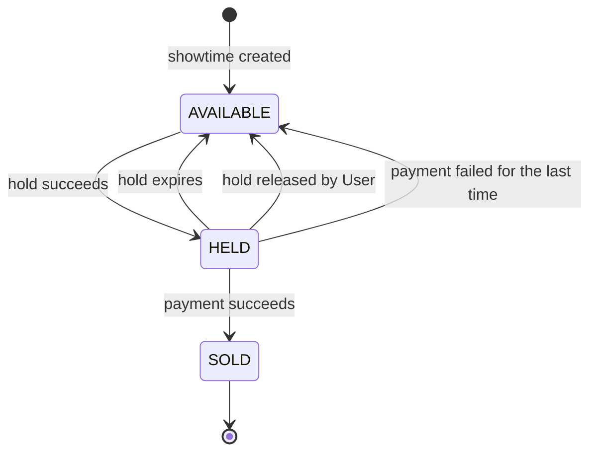
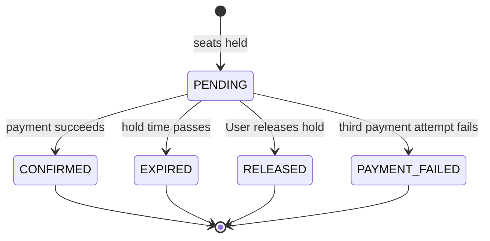
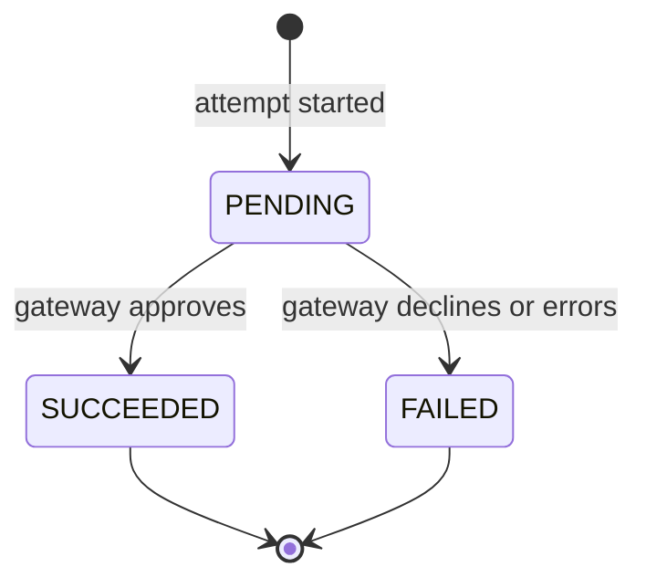

# State machines

The lifecycle of a seat, a booking and a payment attempt. These machines decide which status columns exist and which transitions the code must allow or forbid. Rule IDs (`BR-xx`) refer to [requirements.md](requirements.md).

Three principles apply to all of them:

1. **Only the transitions listed here are legal.** Any other transition is a bug and must be rejected, not silently ignored.
2. **A booking transition and the seat transitions it causes happen in one database transaction.** There is no moment when a booking says `CONFIRMED` but its seats are still `HELD`.
3. **Time is read from an injectable clock** (UTC), so expiry can be tested without waiting.

## 1. Seat (per showtime)

A physical seat belongs to a room. What changes over time is the state of that seat **in one showtime**, so the state belongs to the pair (showtime, seat), not to the physical seat.

| From | Event | To | Guard | Side effect |
|---|---|---|---|---|
| (none) | Showtime created | `AVAILABLE` | Showtime is valid (BR-09, BR-10) | One row per seat of the room |
| `AVAILABLE` | Hold succeeds | `HELD` | Sales are open (BR-18); all requested seats are available (BR-19) | Linked to a `PENDING` booking |
| `HELD` | Payment succeeds | `SOLD` | Booking is `PENDING` and not expired (BR-24) | Permanent (BR-26) |
| `HELD` | Hold expires | `AVAILABLE` | `now >= expires_at` of the booking | Booking becomes `EXPIRED` |
| `HELD` | User releases hold | `AVAILABLE` | Booking is `PENDING` and owned by the caller | Booking becomes `RELEASED` |
| `HELD` | Last payment attempt fails | `AVAILABLE` | Third failed attempt (BR-25) | Booking becomes `PAYMENT_FAILED` |

**Forbidden transitions**

- `AVAILABLE → SOLD`: a seat must be held before it can be sold. This also prevents selling a seat without a booking.
- `SOLD → anything`: sold seats never return, because cancelling confirmed bookings is out of scope.
- `HELD → HELD` for a different booking while the first hold is still valid.

**Effective state (BR-20).** A `HELD` seat whose booking has passed its `expires_at` is treated as `AVAILABLE` immediately, even if the cleanup job has not yet written that change. So the state a client sees is derived from the stored state **and** the clock. The stored state catches up within 60 seconds (NFR-05).

## 2. Booking

A booking is created when seats are held and ends in exactly one terminal state.

| From | Event | To | Guard | Seats |
|---|---|---|---|---|
| (none) | Hold succeeds | `PENDING` | BR-14 to BR-19 | `AVAILABLE → HELD` |
| `PENDING` | Payment attempt succeeds | `CONFIRMED` | `now < expires_at`; caller owns the booking; amount equals total (BR-24, BR-27) | `HELD → SOLD`; booking code issued |
| `PENDING` | Time passes | `EXPIRED` | `now >= expires_at` | `HELD → AVAILABLE` |
| `PENDING` | User releases | `RELEASED` | Caller owns the booking | `HELD → AVAILABLE` |
| `PENDING` | Payment attempt fails | `PENDING` (stays) | Fewer than 3 failed attempts and not expired | Unchanged |
| `PENDING` | Third payment attempt fails | `PAYMENT_FAILED` | Third failed attempt (BR-25) | `HELD → AVAILABLE` |

**Forbidden transitions**

- `EXPIRED → CONFIRMED`: a payment that arrives after expiry is rejected, even if the seat is still free. Allowing it would mean charging for a seat another User may already hold.
- `CONFIRMED → anything`: confirmed bookings are final in the MVP.
- Any move out of `EXPIRED`, `RELEASED` or `PAYMENT_FAILED`: a User who wants the seats again starts a new booking.

**Effective state.** A `PENDING` booking with `now >= expires_at` behaves as `EXPIRED` for every operation (pay, release, list), regardless of whether the cleanup job has run.

**Race to resolve at design time (ADR-0002).** Payment success and expiry can happen at almost the same instant. Exactly one must win, and the loser must not leave a half-applied result. This is one of the cases the concurrency tests should cover.

## 3. Payment attempt

Each try to pay creates one payment record. A booking can have up to three.

| From | Event | To | Guard | Effect on booking |
|---|---|---|---|---|
| (none) | User pays | `PENDING` | Booking is `PENDING`, not expired, fewer than 3 failed attempts | None yet |
| `PENDING` | Gateway approves | `SUCCEEDED` | None | Booking becomes `CONFIRMED` |
| `PENDING` | Gateway declines | `FAILED` | None | Booking stays `PENDING`, or becomes `PAYMENT_FAILED` after the third failure |
| `PENDING` | Gateway error or timeout | `FAILED` | None | Same as declined |

**Notes**

- A payment is never edited after it reaches `SUCCEEDED` or `FAILED`; a retry is a new record. This keeps a complete history of attempts (US-20).
- A booking can have at most one `SUCCEEDED` payment.
- The gateway is a simulated stub. With a real gateway, a timeout would leave the outcome **unknown**, requiring a reconciliation step; the MVP treats it as `FAILED` and does not model that case.
- Repeating a pay request with the same `Idempotency-Key` returns the stored result and creates no new payment (BR-28).

## 4. Consistency rules between the machines

These invariants must always hold. They are the basis for integration tests and for the database constraints in [erd.md](erd.md).

| # | Invariant |
|---|---|
| I-1 | A seat in a showtime is part of **at most one active booking** (`PENDING` or `CONFIRMED`) at any time. This is the double-booking guarantee. |
| I-2 | A seat is `HELD` only if an active `PENDING` booking contains it. |
| I-3 | A seat is `SOLD` if and only if a `CONFIRMED` booking contains it. |
| I-4 | A booking is `CONFIRMED` if and only if it has exactly one `SUCCEEDED` payment. |
| I-5 | A booking in `EXPIRED`, `RELEASED` or `PAYMENT_FAILED` contains no seat in state `HELD` or `SOLD`. |
| I-6 | A `PENDING` booking has no `SUCCEEDED` payment and at most 2 `FAILED` payments. |
| I-7 | A booking's total equals the sum of the seat prices copied at hold time (BR-22). |
